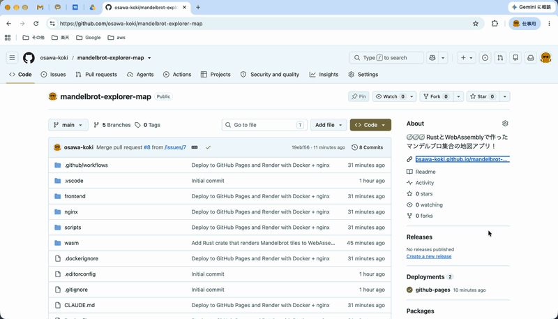

# Mandelbrot Explorer Map

[](https://github.com/osawa-koki/mandelbrot-explorer-map/actions/workflows/app-ci.yml)
[](https://github.com/osawa-koki/mandelbrot-explorer-map/actions/workflows/pages.yml)
[](https://github.com/osawa-koki/mandelbrot-explorer-map/actions/workflows/dependabot/dependabot-updates)

🧭🧭🧭 RustとWebAssemblyで作ったマンデルブロ集合の地図アプリ！  

  

[osawa-koki/mandelbrot-map](https://github.com/osawa-koki/mandelbrot-map) をもとに、サーバーサイドを持たずブラウザだけで完結する形に作り直したもの。計算は Rust で書いて WebAssembly にコンパイルし、Web Worker で並列に実行する。

## 機能

- ドラッグ（慣性つき）・ホイール・トラックパッド・ピンチでの移動と拡大縮小。ダブルクリック（Shift で縮小）、ズームボタン、キーボード（矢印キー、`+` / `-`、`0` で初期位置）にも対応
- 約 ×4×10¹² 倍（ズームレベル 42、倍精度浮動小数点数の限界付近）まで拡大できる
- 計算が終わるまでは、キャッシュにある粗い（または細かい）タイルで仮に表示する
- カラースキーム（Classic / Fire / Ocean / Neon / Mono）、最大反復回数（自動または固定）、アンチエイリアス
- 表示位置と設定を URL に保存する（ブックマーク・共有ができる。「リンクをコピー」ボタンあり）
- 高 DPI の画面では、物理ピクセルの細かさで計算する

## 構成

| ディレクトリ | 役割 | 技術 |
|---|---|---|
| `wasm/` | タイル 1 枚（256 × 256 ピクセル）の計算と色付け | Rust → WebAssembly（`wasm32-unknown-unknown`） |
| `frontend/` | Canvas のタイルマップ、操作、設定 | TypeScript / Vite |
| `Dockerfile`・`nginx/` | ビルドした静的ファイルを nginx で配信するイメージ（Render 用） | Docker / nginx |

### 計算の流れ

1. 画面を、ズームレベルに合ったタイル（レベル L のタイルは一辺 `4 / 2^L`）に分ける
2. 足りないタイルを、画面の中心に近い順に Worker のプール（CPU のコア数 − 1 個）に渡す
3. 各 Worker は WebAssembly のモジュールを 1 つずつ持ち、タイルの RGBA を計算して `ImageBitmap` で返す
4. メインスレッドは `ImageBitmap` を LRU キャッシュに入れて Canvas に描く

Rust 側では次のように計算を減らしている。

- 主カルジオイドと周期 2 の円の内側は、反復せずに集合内と判定する
- 周期検出（Brent 法）で、集合内の点を最大反復回数より前に打ち切る
- 色はスムーズカラーリング（正規化した反復回数）で、パレットは前もって 2048 段の表にしておく

WebAssembly のモジュールは wasm-bindgen を使わず、`extern "C"` の関数（`renderer_new` / `renderer_render` / `renderer_pixels` / `tile_size`）だけを export している（約 22KB、import なし）。

## 開発環境

**前提条件**：Rust（`wasm/rust-toolchain.toml` のバージョンを rustup が自動で入れる）、Node.js 24 以上

```bash
cd ./frontend/
npm ci
npm run dev     # http://localhost:3000
```

`dev` / `build` / `test` / `typecheck` は、先に `npm run build:wasm`（Rust を WebAssembly にビルドして `frontend/src/generated/` にコピー）を実行する。

| コマンド | 内容 |
|---|---|
| `npm run dev` | 開発サーバー |
| `npm run build` | 本番ビルド（`frontend/dist/`） |
| `npm test` | フロントエンドのテスト（vitest。WebAssembly の出力も確認する） |
| `npm run typecheck` | 型チェック |
| `cargo test`（`wasm/` で） | Rust のテスト |

### URL のパラメータ

| パラメータ | 内容 |
|---|---|
| `re` / `im` | 画面中心の座標 |
| `z` | ズームレベル（1 増えると 2 倍。省略すると集合全体が収まる倍率） |
| `scheme` | `classic` / `fire` / `ocean` / `neon` / `mono` |
| `iter` | 最大反復回数（`auto` または `256`〜`16384`） |
| `aa` | アンチエイリアス（`1` で有効） |

例：`?re=-0.743643887037158&im=0.131825904205311&z=30&scheme=fire&iter=auto&aa=0`

## デプロイ

ビルドした静的ファイル（`frontend/dist`）だけを配信する。次の 2 か所にデプロイする。

### GitHub Pages

`main` への push で、`.github/workflows/pages.yml` がビルドしてデプロイする（手動実行もできる）。Vite の `base` を相対パス（`./`）にしているので、サブパス（`https://<ユーザー>.github.io/mandelbrot-explorer-map/`）でも動く。

初回だけ、リポジトリの Settings → Pages の Source を「GitHub Actions」にする。

### Render（Docker）

`render.yaml`（Blueprint）で設定している。Render のダッシュボードで New → Blueprint からこのリポジトリを接続すると、`main` への push ごとにデプロイされる。

`Dockerfile` はマルチステージビルドで、Rust（WebAssembly）→ Node.js（Vite）→ nginx の順にビルドする。nginx は環境変数 `PORT`（Render が渡す。既定は 8080）で待ち受ける。

| パス | 内容 |
|---|---|
| `/healthz` | ヘルスチェック（`ok` を返す） |
| `/assets/*` | `Cache-Control: public, max-age=31536000, immutable`（ファイル名にハッシュが付く） |
| それ以外 | `Cache-Control: no-cache` |

すべての応答に CSP（WebAssembly のため `'wasm-unsafe-eval'` を許可）などのセキュリティヘッダーを付け、gzip で圧縮する。

ローカルで確認する：

```bash
docker build -t mandelbrot-explorer-map .
docker run --rm -e PORT=8080 -p 8080:8080 mandelbrot-explorer-map
./scripts/check-server.sh http://localhost:8080   # 応答とヘッダーを確認する
```
